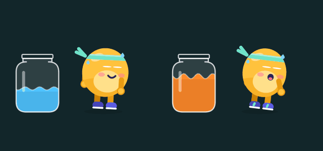

# Kou in Rive: making the mascot come alive

Right now Kou is drawn in code (`Walkou/Features/Mascot/MascotRenderer.swift`). That works, but the movement is simple. With [Rive](https://rive.app) you can animate Kou by hand: a bouncy run, squash and stretch, real facial expressions. Then you export one `.riv` file, and the app plays it instead of the code drawing.

## Before you start: cost

- **Designing** in Rive is free.
- **Exporting the `.riv` file** that the app needs requires a paid plan. The cheapest plan was about $9/month in late 2025, but check [rive.app/pricing](https://rive.app/pricing) for the current price.
- Exported files keep working if you cancel later.

You can design everything on the free plan and pay for one month only when Kou is ready to export.

## Step 1: Start from the current Kou

`docs/kou-svg/` has Kou at every stage as SVG files. Drag one into a new Rive file (start with `kou-3-athlete.svg`: it has the headband, stripes and bib). Rive turns it into editable shapes, which you can then:

1. Rename the artboard to **Kou**. Keep a **5:6 shape** (for example 200 × 240), with Kou facing **right** and their feet near the bottom edge.
2. Group the parts so they can move separately:
   - body
   - belly
   - left eye and right eye
   - mouth
   - back arm and front arm
   - back leg and front leg
   - shoes
   - headband
   - headband tails
   - bib
   - medal
   - sweat beads
3. Optional: add **bones** to the arms and legs (Rive's *Bone* tool) so swinging them is easy.

You can also redraw Kou completely. Only the names in step 3 have to match.

## Step 2: Animate (timelines)

Make one timeline per pose. Turn on **loop** for all of them:

| Timeline | Length | What happens |
|---|---|---|
| `idle` | ~3 s | Slow breathing (body squashes 2%), one blink |
| `ready` | ~1 s | Slight crouch, small bounce, focused eyes |
| `walk` | ~1.05 s | One full stride: legs swing, arms swing opposite, small bob |
| `run` | ~0.7 s | Bigger stride, body leans forward, mouth open, panting |
| `cheer` | ~0.6 s | Jumping, both arms up, happy closed eyes |
| `rest` | ~3 s | Eyes closed, slow breathing, a "z" floating up |

Tips:
- **Squash and stretch** make it feel alive. Squash the body a little on each landing and stretch it on each push off.
- **Overlap:** the headband tails should move a moment *after* the body does.
- Keep it **cute, never sad**. Kou never cries or looks disappointed. On rest days Kou just naps.

## Step 3: State machine (the app talks to it)

Add a **state machine** named exactly **`Kou`** with these inputs. The names must match exactly, including lowercase.

| Input | Type | Values |
|---|---|---|
| `pose` | Number | 0 = idle, 1 = ready, 2 = walk, 3 = run, 4 = cheer, 5 = rest |
| `stage` | Number | 0 = Couch Bean, 1 = Warming Up, 2 = Getting Fit, 3 = Athlete, 4 = Legend |
| `sweat` | Number | 0–100: how sweaty Kou looks (show the sweat beads above ~25 and ~60) |
| `seal` | Trigger | Fired when a jar is sealed: a quick happy hop |

- **Layer 1 ("Pose"):** connect every pose timeline from *Any State*, with conditions like `pose == 2`.
- **Layer 2 ("Looks"):** use `stage` to show or hide the accessories:
  - Headband from stage 1.
  - Racing stripes and a slimmer body from stage 2.
  - Bib at stage 3.
  - Medal at stage 4.

  A simple way is one short timeline per stage that sets the opacity of those parts.

Test it in Rive's *Play* mode by changing the inputs by hand.

## Step 4: Export and send it to me

1. **Export → For Runtime** saves a file like `kou.riv`.
2. Put it in the project at `Walkou/Resources/Mascot/kou.riv`. The easiest way is GitHub in a browser: open the branch, *Add file → Upload files*.
3. Tell me it's there.

I'll then:
- Add Rive's iOS library (the `rive-ios` Swift package) to the project.
- Swap the code-drawn Kou for your file in all three places: the workout panel, Home and the Pantry. The app sends `pose`, `stage` and `sweat` as you walk and fires `seal` when a jar is sealed.
- Keep the code-drawn Kou as a fallback if the file is missing.

The jar, flying sweat drops and sloshing stay in code. They depend on live step data and are already cheap to draw.

## Not ready to pay for Rive?

- **Keep improving the code version.** Tell me what to change (face, colors, proportions, poses), and I'll update it and send a new preview.
- **Commission an illustrator/animator.** Give them this document: the input table is all they need to make a file that plugs straight in.
- **Lottie** (After Effects or LottieFiles) also works on iOS. It plays fixed clips, though, so switching poses smoothly is harder than with Rive's state machine.
